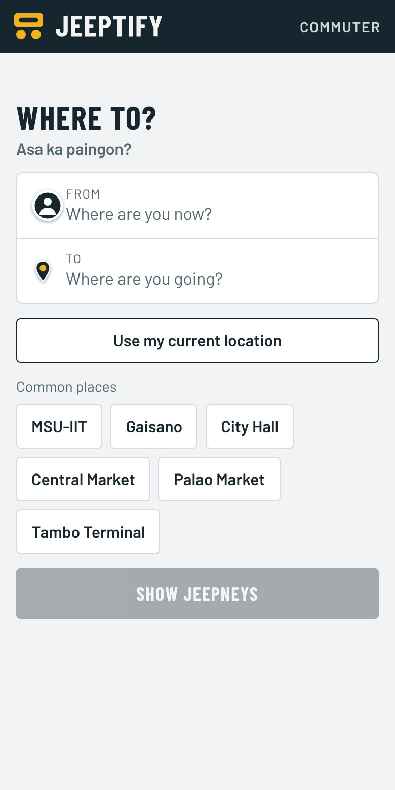
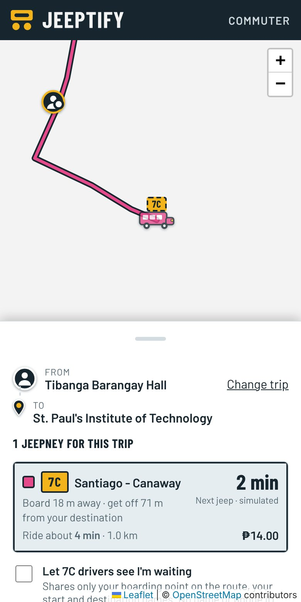
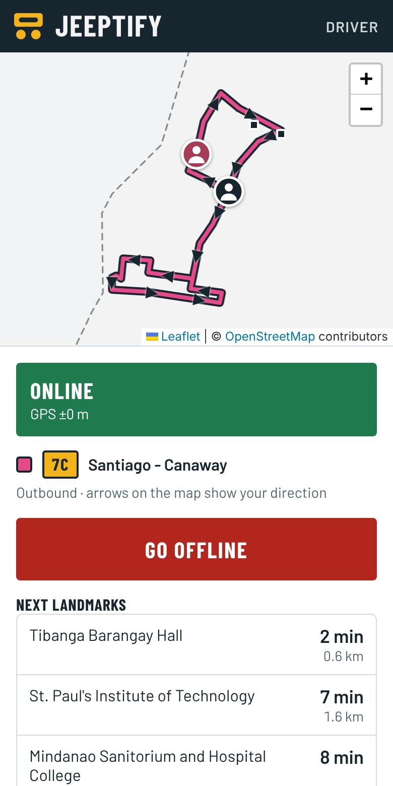
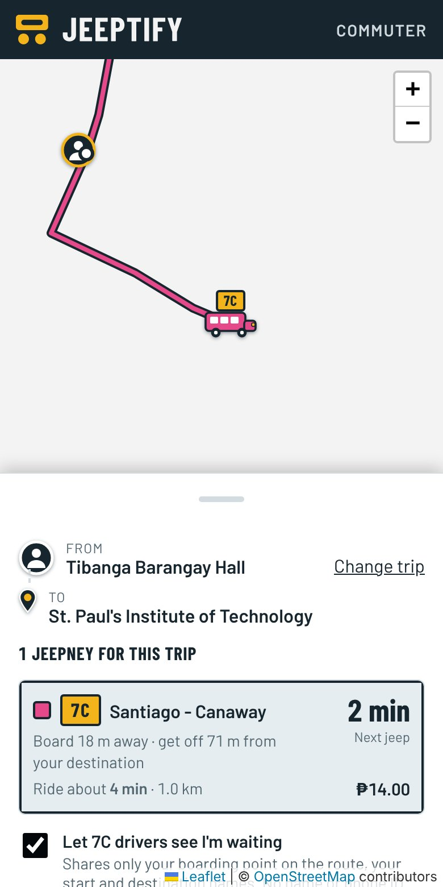

# Jeeptify

**Status: in development (course project, CCC181, MSU-IIT)**

Jeeptify shows Iligan City commuters where jeepneys are right now, so they can tell whether a jeep is still running on their route before they wait. Drivers share their phone's location; commuters see the jeeps that serve their trip, the next jeep's ETA, and the fare.

| Where to? | Results | Driver mode | Waiting commuter |
|-----------|---------|-------------|------------------|
|  |  |  |  |

Screenshots use simulated jeeps. The map background is blank in these images; in the app it shows OpenStreetMap tiles.

## Features

- **Commuter:** pick From and To (or use GPS), then see only the jeepneys that serve that trip: route code, next-jeep ETA, where to board and get off, and the fare.
- **Live map:** jeep markers move along the route. Simulated jeeps fill in for routes with no driver online and are labelled as simulated.
- **Driver mode:** go online on a route and direction, see the next landmarks with ETA and commuters who opted in to show they are waiting on that route. No accept/reject actions, to keep drivers focused on the road.
- **Iligan-only map:** the city outline limits panning; outside areas are greyed.

## Tech Stack

| Area | Tools |
|------|-------|
| Frontend | React 19, TypeScript, Vite |
| Map | Leaflet, OpenStreetMap tiles |
| Tests | Vitest (unit), Playwright + axe-core (browser and accessibility checks) |

## Run

```bash
cd app
npm install
npm run dev          # http://localhost:5173
npx vitest run       # unit tests
```

Open `?mode=driver` in one tab and `?mode=commuter` in another to see a driver's position reach the commuter view.

## Current limits

- Live positions use a browser-local demo channel (one browser, several tabs). A real backend for live sharing is planned.
- Only 13 of about 48 jeepney routes have map geometry, and those are not field-verified.
- Fares and ETAs are estimates (no live traffic data).
- Android build and real-phone testing are not done yet.

## Data sources

- Route lines and fares: [BetterIligan](https://github.com/KishonShrill/BetterIligan) (MIT license), unverified.
- Landmarks and map tiles: © OpenStreetMap contributors (ODbL).
